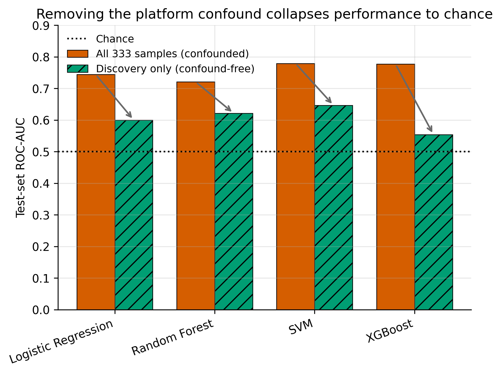
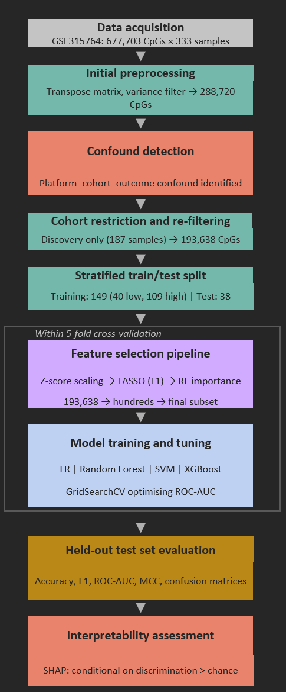
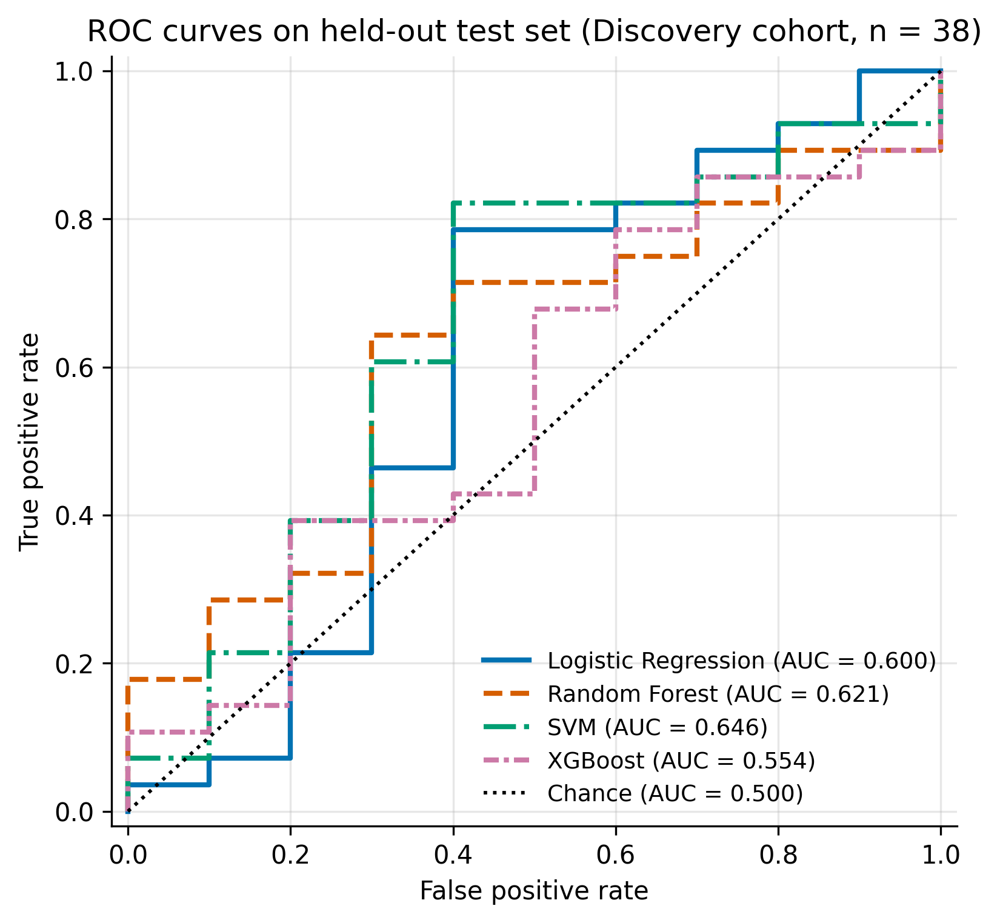
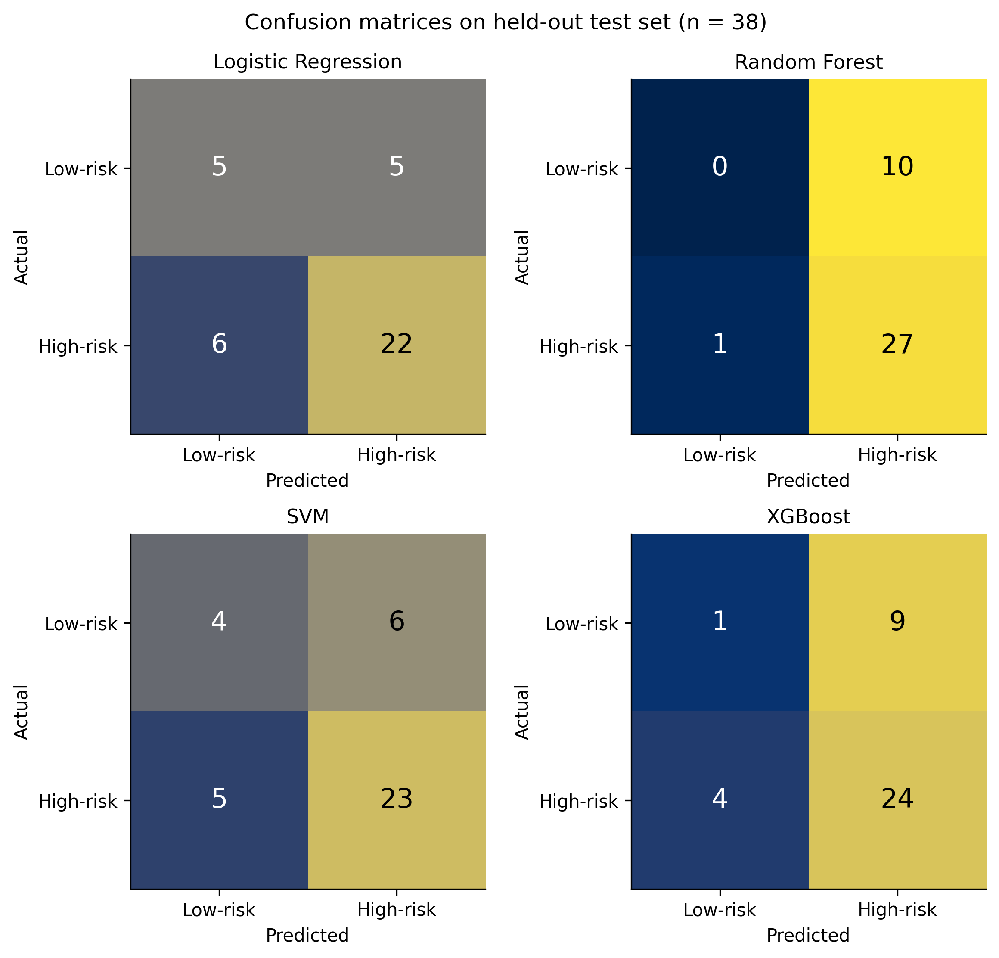
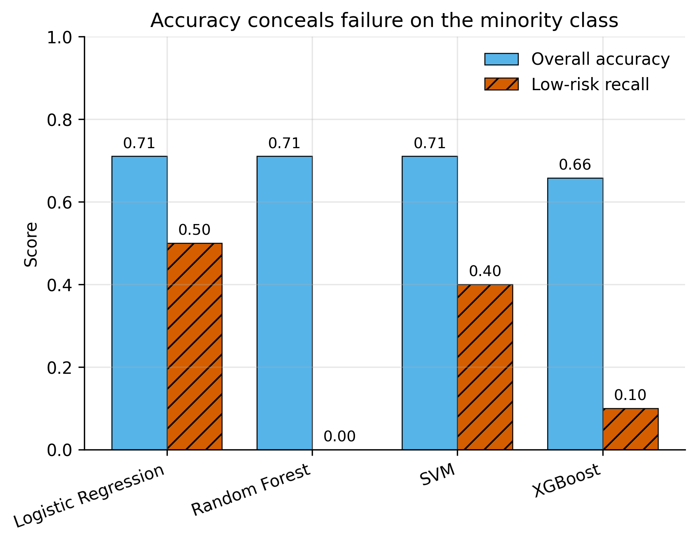
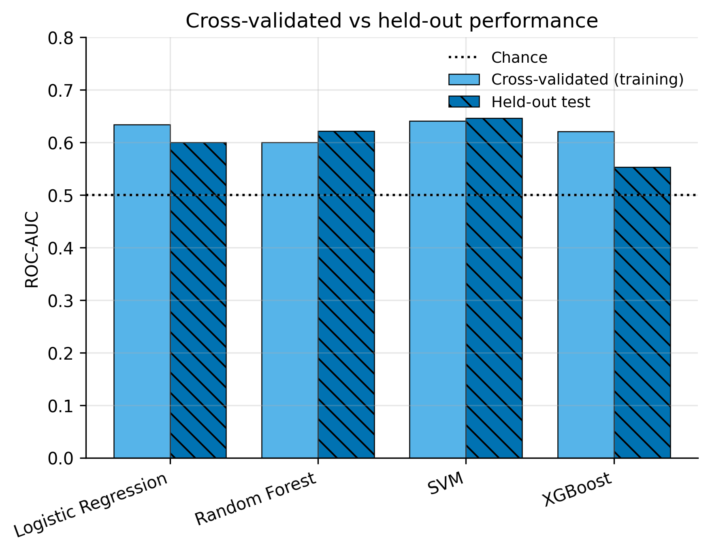

# Prediabetes risk from DNA methylation: a machine learning evaluation

**MSc Data Science dissertation · University of Sheffield · 2026**
[Read the dissertation (PDF)](docs/dissertation.pdf)

Can blood DNA methylation tell people at low risk of prediabetes apart from people at high risk? This project trained and compared four supervised models (Logistic Regression, Random Forest, SVM and XGBoost) on genome-wide methylation data from 333 people, measured at 677,703 CpG sites.

## The key finding: a hidden confound

Exploring the data before modelling showed that **array platform, study cohort and outcome were perfectly confounded**:

| Cohort | Array platform | Samples | Low-risk | High-risk |
|---|---|---|---|---|
| Discovery | Illumina EPIC v1 | 187 | 50 | 137 |
| Replication | Illumina EPIC v2 | 146 | 0 | 146 |

Every sample measured on the newer chip was high-risk, so a model could score well just by recognising the chip's technical signature. Trained on all 333 samples, the models reached an apparently promising **mean test ROC-AUC of 0.755**. Restricted to the single-platform Discovery cohort, where that shortcut no longer exists, performance **fell to a mean of 0.605, close to chance (0.5)**.



All four algorithms, despite their very different assumptions, ended up near chance. This points to a property of the data rather than a weakness of any one model. Because attributions from chance-level models would describe noise, the planned SHAP biomarker analysis was deliberately not carried out.

## Method



- **Data:** [GSE315764](https://www.ncbi.nlm.nih.gov/geo/query/acc.cgi?acc=GSE315764) from the NCBI Gene Expression Omnibus (processed beta values). The four prediabetes clusters were grouped into low-risk (C2) and high-risk (C3, C5, C6).
- **Preprocessing:** variance filtering (677,703 → 288,720 CpGs), then repeated within the Discovery cohort (→ 193,638 CpGs) to remove variation that came from the platform rather than from people.
- **Split:** stratified 80/20 train/test split (149 training, 38 test samples). The test set was used once, at the very end.
- **No data leakage:** scaling and two-stage feature selection (LASSO, then Random Forest importance) sit *inside* scikit-learn pipelines, so they are refitted on every cross-validation fold. With ~194k features and 187 samples, selecting features before splitting would badly inflate the results.
- **Tuning:** `GridSearchCV` with 5-fold stratified cross-validation, optimising ROC-AUC rather than accuracy.
- **Class imbalance:** balanced class weights (`scale_pos_weight` for XGBoost); evaluation with ROC-AUC, Matthews Correlation Coefficient (MCC) and low-risk recall, not just accuracy.
- **Accessible figures:** the Okabe–Ito colour-blind-safe palette, with line styles and hatching as a second cue.

## Results on the held-out test set (Discovery cohort, n = 38)

| Model | Accuracy | F1 | ROC-AUC | MCC |
|---|---|---|---|---|
| Logistic Regression | 0.711 | 0.800 | 0.600 | 0.277 |
| Random Forest | 0.711 | 0.831 | 0.621 | −0.098 |
| SVM | 0.711 | 0.807 | 0.646 | 0.229 |
| XGBoost | 0.658 | 0.787 | 0.554 | −0.056 |

Accuracy alone is misleading here: Random Forest scored 71.1% accuracy while classifying **all ten** low-risk test samples as high-risk.

| | |
|---|---|
|  |  |
|  |  |

## What I took from it

Checking how the data was collected matters as much as choosing the model. Without the confound check, this study would have reported AUCs of 0.72 to 0.78 and claimed a methylation signal that was really a batch effect. A careful negative result is still a result.

## Running it

```bash
pip install -r requirements.txt
```

1. From the [GSE315764 page](https://www.ncbi.nlm.nih.gov/geo/query/acc.cgi?acc=GSE315764), download these into `Data/raw/`:
   - `GSE315764_combined_methylation.csv.gz` (about 1.8 GB)
   - `GSE315764-GPL21145_series_matrix.txt.gz` and `GSE315764-GPL33022_series_matrix.txt.gz` (the two series matrix files)
2. Run `python code/01_prepare_data.py` once. It builds the labels and a cached, variance-filtered matrix in `Data/interim/` (needs about 2 GB of RAM and a few minutes).
3. Run `python code/02_modelling.py` (or its `# %%` cells in VS Code, with this folder open). It writes the figures and tables to `results/`.

All random processes use seed 42, so the results are reproducible.

## Repository

| Path | What |
|---|---|
| `code/01_prepare_data.py` | Parses the GEO metadata, detects the confound, variance-filters and caches the data |
| `code/02_modelling.py` | Discovery-only split, leakage-safe pipelines, tuning, the single test-set evaluation, figures |
| `results/` | Figures 1 to 5 and the cross-validation and test-set tables |
| `docs/dissertation.pdf` | The full dissertation (the ethics approval letter is omitted from this public copy) |
| `docs/pipeline.png` | Pipeline overview diagram |
